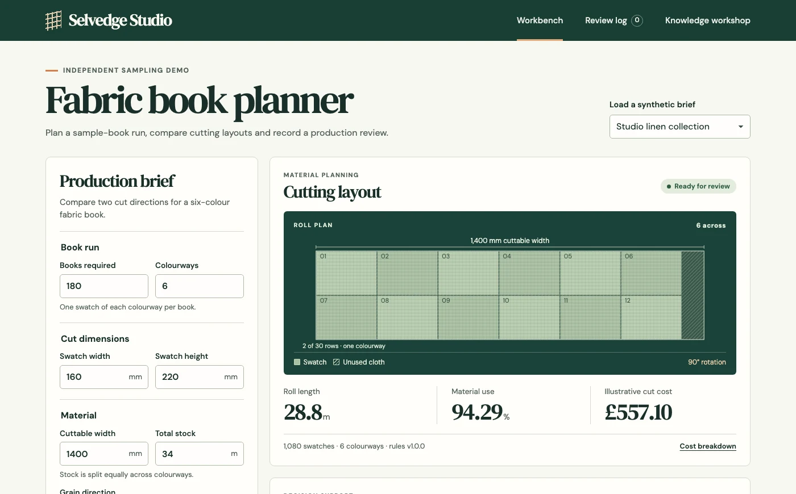

# Selvedge Studio

**[Try the knowledge workshop](https://rongsenzhang.github.io/selvedge-sampling-studio/workshop.html)** · [Open the fabric book planner](https://rongsenzhang.github.io/selvedge-sampling-studio/) · [Version 1.0 release](https://github.com/rongsenzhang/selvedge-sampling-studio/releases/tag/v1.0.0)

A small interiors collection needs 180 presentation books in six colourways. Will rotating each swatch save material? What happens if the cloth must run in one direction, or the stock is short? Selvedge Studio takes that brief from layout and costing to an explained production review.

Independent application demonstrator for the **Smart Design Software Engineer KTP Associate** role at the University of Suffolk and Pike Textiles. It uses synthetic jobs, assumed equal stock by colour and illustrative rates. The application does not connect to a factory or issue commercial quotations. [University vacancy](https://careers.uos.ac.uk/job/989445) · [Public research and competitor comparison](docs/research.md)

[中文技术路线与演示指南](docs/guide-zh.md)

## Try the v1.1 workshop

Enter a synthetic observation such as “For a fraying edge, reserve 7% of the planned cut length for a trial cut.” Select **Generate a draft** to call the live service. Inspect the quoted evidence, the follow-up question and the counterexample. Select **Use 7% in the draft** to copy the figure, then **Test proposal** to see what happens to a tight-stock job. You can always test a percentage manually. Two genuine recorded responses are also available with their model and generation time. [Workshop examples, architecture and verification](docs/ai-workshop.md)

## Two minutes at the workbench

1. Open **Studio linen collection**. Expand **Compare cutting directions**. The standard cut uses 30.36 m. Rotation uses 28.80 m. Set **Grain direction** to **Keep original direction** and watch the plan change.
2. Load **Short-roll launch**. Read the stock check. Eight colours need 49.20 m altogether, with a 12.20 m shortfall. Change total stock to 49.20 m and observe the boundary. This assumes equal usable length for every colour.
3. Load **Archive weave collection**. A directional cut fits, but the fraying edge needs a physical trial. Add a reviewer note, save and download its JSON. Open the review log after a reload to recover the snapshot.
4. In the **[knowledge workshop](https://rongsenzhang.github.io/selvedge-sampling-studio/workshop.html)**, test a proposed trial-cut allowance against three fixtures and export the evidence for a rule owner's decision.

Visitors can use the public app without an account, API key or payment. Saved reviews belong to the current browser profile and device. Export one to share it. The Node edition below offers a persistent database and HTTP integration.



## Explore the engineering evidence

| Question | Where to look |
| --- | --- |
| What does Pike make, and what do direct competitors already offer? | [Company research, three competitors and the site inventory](docs/research.md) |
| Why this workflow, architecture and data model? | [Technical route, system diagram and API contract](docs/technical-route.md) |
| Can I check the metres, pence, rule states and case ranking myself? | [Worked example and model assumptions](docs/model.md) · [decision engine](public/lib/engine.mjs) |
| How does AI interpret an observation, and who accepts the number? | [AI workshop and deployment checks](docs/ai-workshop.md) |
| What actually passed, and what would need a site trial? | [Validation record](docs/validation.md) · [automated runs](https://github.com/rongsenzhang/selvedge-sampling-studio/actions) |
| How could supervisors test employee adoption, manage risk and disseminate results? | [KTP responsibilities, training, field study and 24-month pilot proposal](docs/ktp-delivery.md) |

## Run the full-stack edition

Use Node.js 24 or later. The application and unit/API tests use only built-in runtime modules.

```sh
npm start
# Open http://127.0.0.1:4173
npm test
```

The local edition serves the same UI, persists reviews in `data/studio.sqlite` and streams review updates to other open clients. Set `STUDIO_DB`, `HOST` or `PORT` to change these defaults. The development container also starts this server and forwards port 4173.

To enable live workshop drafting locally, set the server’s `OPENAI_API_KEY` through your environment or secret manager before starting Node. The planner and manual workshop also run without it. [AI runtime and quotas](docs/ai-workshop.md)

For the browser regression suite:

```sh
npm ci
npx playwright install chromium
npm run test:browser
```

Set `STUDIO_URL` to run the public-site checks against a deployed copy. The Pages workflow runs the automated checks before publishing the `public/` directory.

## Project provenance

This portfolio prototype was developed with AI assistance in research, implementation, documentation and test execution. Business descriptions are sourced, and all briefs, history cards, cost rates and workshop observations are synthetic. Independent delivery can be assessed by asking the applicant to explain the hand calculation, change a rule, run the tests or adapt the model live. Company interviews, a shop-floor trial and university research outputs remain future work.

The self-hosted DM Sans and DM Serif Text fonts include their respective OFL notices in [public/fonts](public/fonts). All layout illustrations are drawn from the current brief.
