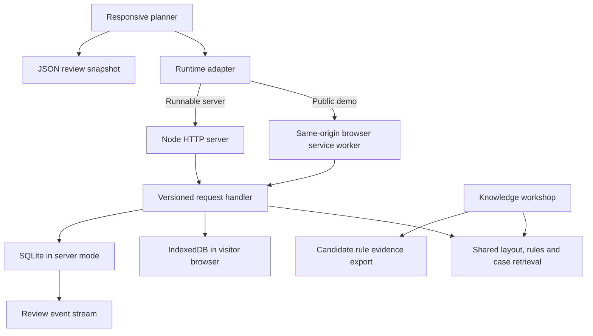

# Technical route and acceptance criteria

A reviewer can enter a fabric sample-book brief, check how direction and edge behaviour affect the cut, explain an exception and hand over a reproducible decision. This is a bounded example of the Smart Design Software Engineer brief at the University of Suffolk and Pike Textiles.

## Scope decisions

| Choice | Why it fits the evidence | Acceptance check |
| --- | --- | --- |
| Start with fabric swatches for one sample-book run | Pike describes layout advice, difficult-to-handle fabrics and edge treatment. Its own stock and fulfilment offering makes an estimator-to-production handover a relevant question. | A reviewer can compare two cut plans, explain a material hold and see the inputs that produced it. |
| Use a constrained search and explicit decision rules | The feasible action space has two uniform orientations. Enumerating both gives a checkable minimum for this restricted problem. Human expertise is needed for direction, appearance and finishes. | Independent whole-row tests and a hand-worked example agree with the engine. Impossible layouts cannot produce a cost. |
| Retrieve comparable cases with a transparent scoring function | Six synthetic job cards illustrate one way to consult history. The weights can be scrutinised and changed after discovery. | A reviewer can read each returned job's differences and scoring method. No claimed predictive accuracy or financial return. |
| Make review notes immutable snapshots | Someone receiving an estimate needs the inputs, result, rationale and rule version as they were at review time. | Save, reload, export and inspect the record. Replaying the same request ID produces one row. |
| Let an expert test a proposed rule away from live decisions | The production judgment can be written down, tested against examples and challenged before adoption. | Run the knowledge workshop, compare current and proposed outcomes and export a draft with evidence. |
| Serve visitors directly from GitHub Pages | A panel member can try the model anonymously on a phone or desktop. The public path incurs no per-evaluation model/API charges. | A clean browser can run all three scenarios from the published project subpath and export a review. |
| Ship the same HTTP contract on Node and SQLite | A team can run the UI against a persistent local service and connect another client to review events. | Verify actual HTTP calls, concurrent retries, persistence across restarts and a received integration event. |

Sources and scope of the domain review are in the [company and competitor research](research.md). See the [geometry and decision model](model.md) for exact assumptions, exclusions and validation boundaries.

## Implementation



The page can analyse briefs and access the same browser store directly during service worker setup or where module service workers are unavailable. Service workers only intercept the dedicated API path. The public demo does not cache the site for offline use. The Node edition uses the same page and request handler, runs independently of a service worker and streams committed review IDs to open clients.

### Data model

| Entity | Identifier | Stored values and relationships |
| --- | --- | --- |
| Scenario and brief | Scenario ID | A synthetic starting point, quantity, colour count, dimensions, grain, edge and stock. Each saved brief has its own copy of the input. |
| Rule | Rule ID + version | Rationale, source or assumption, action and evaluated state. A snapshot retains the full decision and triggered checks. |
| Historical job | Synthetic case ID | Physical and categorical attributes. Ranked by weighted similarity. Retrieval supplies context and has no release authority. |
| Review | Request ID / UUID | Time, starting scenario, note, immutable brief and result, current rules version and status. SQLite enforces unique IDs and a status constraint. The browser uses one record per key in an IndexedDB transaction. |
| Proposed rule | Workshop export | An observation, candidate condition and action, parameter, responsible role, base version and case outcomes. Exported separately to support review before adoption. |

### Integration contract

Run the server with Node 24 or later (`npm start`). The default bind address is 127.0.0.1. The health endpoint reports the runtime data store. Use this mode for scripts, curl, persistence or shared event demonstrations. On GitHub Pages, API requests inside supported, controlled browsers are handled locally by the service worker. An external HTTP client should use the Node server.

| Method | Path | Response |
| --- | --- | --- |
| GET | `/api/v1/health` | Release version, rule version and storage mode |
| GET | `/api/v1/catalogue` | Three starting briefs and rule catalogue |
| POST | `/api/v1/analyse` | Send a brief as JSON. Receive both cut alternatives, demand, illustrative cost lines, checks and matched cases |
| POST | `/api/v1/reviews` | Send `{brief,scenarioId,note,requestId}`. The server recalculates and records. The request ID is optional. A new review returns 201. An identical retry returns 200. A different payload under the same ID returns 409. |
| GET | `/api/v1/reviews` | Up to the 100 most recent saved snapshots in this store |
| GET | `/api/v1/events` | Node-only server-sent event named `review` after a new record commits. Contains ID and timestamp. Fetch the review list to reconcile after reconnecting. |

```sh
curl http://127.0.0.1:4173/api/v1/health
curl -H 'Content-Type: application/json' http://127.0.0.1:4173/api/v1/analyse \
  -d '{"quantity":180,"colourways":6,"swatchWidthMm":160,"swatchHeightMm":220,"rollWidthMm":1400,"stockMetres":34,"grain":"free","edge":"stable"}'
```

Programme-level deployment, access and change control are set out in the [handover and pilot plan](ktp-delivery.md). A deployment with shared business data would require identity and access controls, retention and backup rules, partner-approved rate and stock interfaces, and an agreed route for production sign-off.

## Delivery order

1. Review first-party product and competitor evidence, read the job duties and choose one decision with observable inputs and outcomes.
2. Write the scenario contract and hand calculation. Implement the shared rules and test crop orientation, exact stock boundaries, impossible cuts and brittle inputs.
3. Build the responsive planner, diagram and repeatable review flow. Add the same contract to a local Node service and test its SQL storage and event feed.
4. Demonstrate human knowledge capture with a separate proposed-rule comparison. Provide a training exercise, a risk register and a field evaluation design.
5. Run unit, HTTP and browser checks, publish through GitHub Actions and verify the public URL from a clean browser. The release tag identifies the reviewable version.

The [release validation record](validation.md) identifies the checks actually run and the remaining workplace validation.
